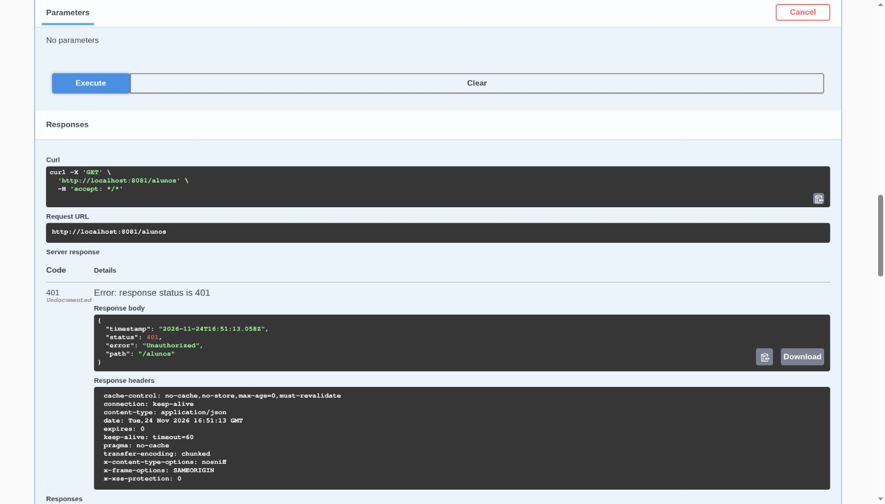
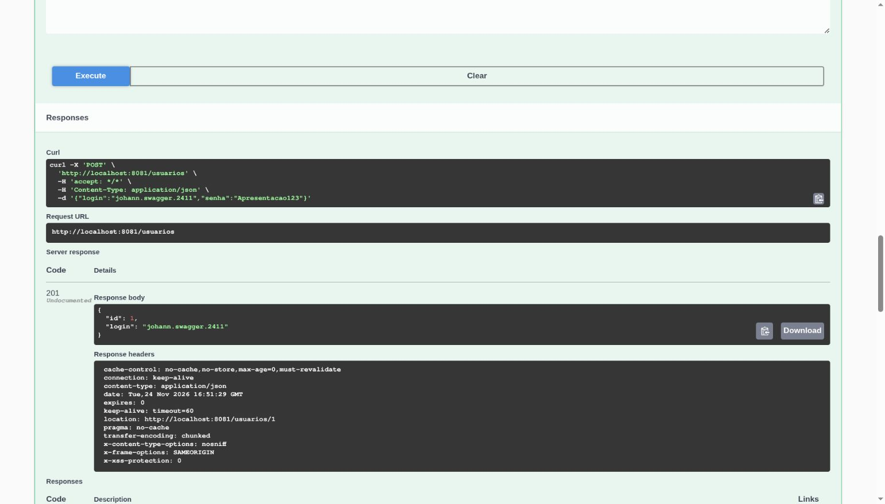
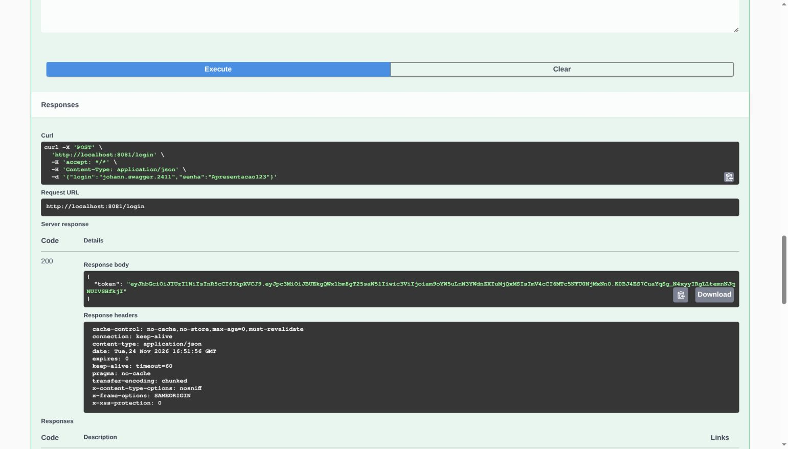
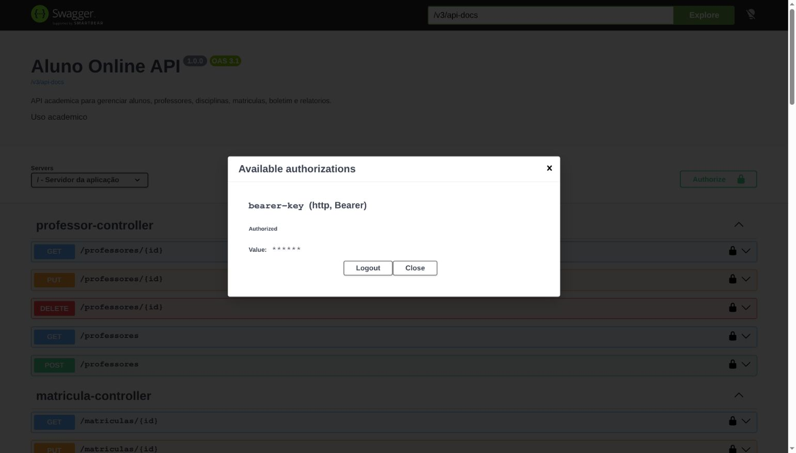
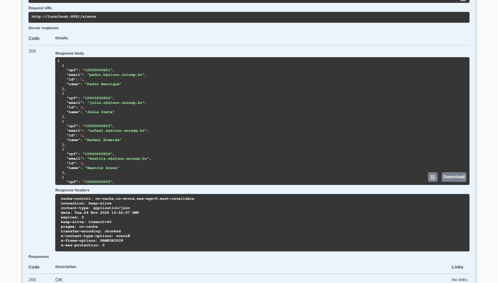
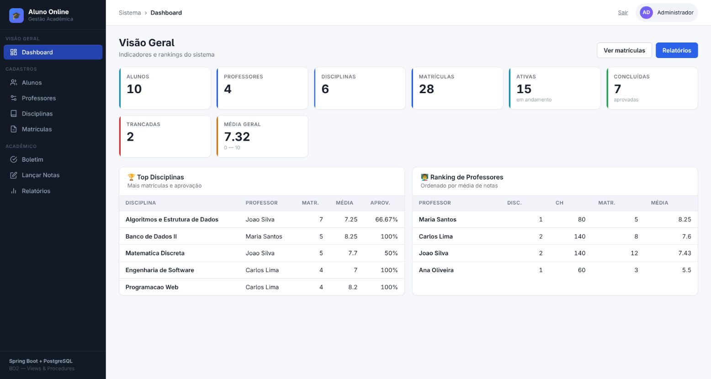

# Roteiro da apresentação — Spring Security

O fluxo pedido é criar um **usuário de acesso** pelo Swagger, entrar com esse usuário, copiar o JWT, autorizar e consultar uma rota protegida. O cadastro de usuário é separado do cadastro de aluno.

## 1. Iniciar banco e aplicação

Abra um terminal na pasta do projeto que contém `pom.xml` e execute:

```bash
bash scripts/apresentar.sh
```

O script usa Java 21, compila o projeto, inicia um PostgreSQL próprio na porta **55434** e a aplicação na porta **8081**. Aguarde aparecer `Started AlunoOnlineApplication`. Deixe o terminal aberto durante a apresentação. `Ctrl+C` encerra os dois processos iniciados pelo script.

Os dados dessa demonstração ficam em `.demo/`, ignorada pelo Git. O script não se conecta ao banco original na porta 5432 e não executa reset. Ao reiniciar, preserva as contas criadas nessa base de demonstração.

- Swagger: <http://localhost:8081/swagger-ui.html>
- Aplicação: <http://localhost:8081/>
- Banco: `127.0.0.1:55434`, nome `aluno_online_demo`, usuário `aluno_demo`. O banco de demonstração aceita conexão local sem senha.

Verificação realizada em 24/11/2026: banco aceitando conexões, 10 alunos, 4 professores, 6 disciplinas e 28 matrículas; Swagger e dashboard funcionando; 28 testes automatizados aprovados.

## 2. Mostrar o bloqueio antes do login

Se o Swagger já estiver autorizado, clique em **Authorize → Logout → Close**. Abra `GET /alunos`, clique em **Try it out → Execute**.

Resultado esperado: **401 Unauthorized**. Isso demonstra que a rota exige autenticação.



## 3. Criar um usuário novo

Abra `POST /usuarios`, clique em **Try it out** e envie:

```json
{
  "login": "johann.apresentacao.01",
  "senha": "Apresentacao123"
}
```

Clique em **Execute**. Resultado esperado: **201 Created**, com `id` e `login`, sem devolver a senha. Escolha um login novo a cada demonstração. Se o login já existir, a resposta será 400; basta mudar o login.

Os prints foram feitos com a conta de teste `johann.swagger.2411`, senha `Apresentacao123`. Ela já existe na base usada nos testes; o exemplo acima serve para você demonstrar um cadastro novo.



## 4. Fazer login e copiar o token

Abra `POST /login`, clique em **Try it out** e envie exatamente o mesmo login e senha cadastrados no passo anterior.

Resultado esperado: **200 OK**, com este formato:

```json
{
  "token": "valor-do-JWT"
}
```

Copie somente o valor do campo `token`, sem as aspas. O JWT identifica o usuário nas próximas chamadas e tem validade de duas horas. A senha fica protegida com BCrypt no banco; ela não é colocada no JWT.



## 5. Liberar as operações no Swagger

Clique em **Authorize**, na parte superior do Swagger. No campo **bearer-key**, cole somente o token. Não escreva `Bearer`: o Swagger acrescenta esse prefixo ao cabeçalho automaticamente.

Clique em **Authorize** e confirme que aparece **Authorized**. Depois clique em **Close**.



## 6. Listar alunos com o token

Execute novamente `GET /alunos`. Agora o resultado deve ser **200 OK**, com a lista de alunos. Na requisição gerada pelo Swagger, o cabeçalho é `Authorization: Bearer <token>`.



Para mostrar a aplicação visual, abra a página inicial e entre com o mesmo usuário. O dashboard usa os dados da API autenticada. A autorização no Swagger e o login da página são feitos separadamente.



## 7. Responder às perguntas sobre o código

| Pergunta | Arquivo e trecho para mostrar |
| --- | --- |
| Onde está o cadeado do Swagger? | [`AlunoController.java`](../src/main/java/br/com/alunoonline/api/controller/AlunoController.java): `@SecurityRequirement(name = "bearer-key")`. Os demais controllers protegidos usam a mesma anotação. |
| Onde é definido o botão Authorize? | [`OpenApiConfig.java`](../src/main/java/br/com/alunoonline/api/config/OpenApiConfig.java): esquema `bearer-key`, tipo HTTP, `scheme("bearer")` e `bearerFormat("JWT")`. |
| O que bloqueia a API de verdade? | [`SecurityConfigurations.java`](../src/main/java/br/com/alunoonline/api/infra/security/SecurityConfigurations.java): `.anyRequest().authenticated()`. Cadastro, login e documentação são públicos. |
| Quem verifica o token? | [`SecurityFilter.java`](../src/main/java/br/com/alunoonline/api/infra/security/SecurityFilter.java): lê o cabeçalho, valida o JWT e preenche o `SecurityContextHolder`. |
| Onde o token é criado e expira? | [`TokenService.java`](../src/main/java/br/com/alunoonline/api/infra/security/TokenService.java): `gerarToken`, assinatura HMAC256 e validade de duas horas. |
| Onde a senha é protegida? | [`UsuarioController.java`](../src/main/java/br/com/alunoonline/api/controller/UsuarioController.java): `passwordEncoder.encode(dados.senha())`. |
| Onde o login é conferido? | [`AutenticacaoController.java`](../src/main/java/br/com/alunoonline/api/controller/AutenticacaoController.java): `authenticationManager.authenticate(...)`. |

Uma explicação curta para falar: “Primeiro cadastro o usuário. No login, o Spring confere a senha e devolve um JWT. Eu autorizo o Swagger com esse token; ele passa a enviá-lo nas requisições. O filtro valida o token e libera a consulta. A anotação do controller desenha o cadeado, e a configuração do Spring Security faz a proteção real.”

## Se algo sair diferente

- **400 no cadastro:** tente um login ainda não usado e preencha os dois campos.
- **401 no login:** confira se o login e a senha são os mesmos do cadastro.
- **401 ao listar:** faça login novamente, copie o token novo e repita o Authorize.
- **Conexão recusada:** execute `bash scripts/apresentar.sh` e aguarde a inicialização.
- **Porta 8081 ocupada:** use `DEMO_APP_PORT=18081 bash scripts/apresentar.sh` e abra o Swagger na porta 18081.

Para repetir a suíte de testes, que usa outro banco descartável e não interfere na apresentação:

```bash
JAVA_HOME=/usr/lib/jvm/java-21-openjdk ./scripts/test-security.sh
```

A correspondência com as aulas está em [SPRING_SECURITY_ETAPAS.md](SPRING_SECURITY_ETAPAS.md).
