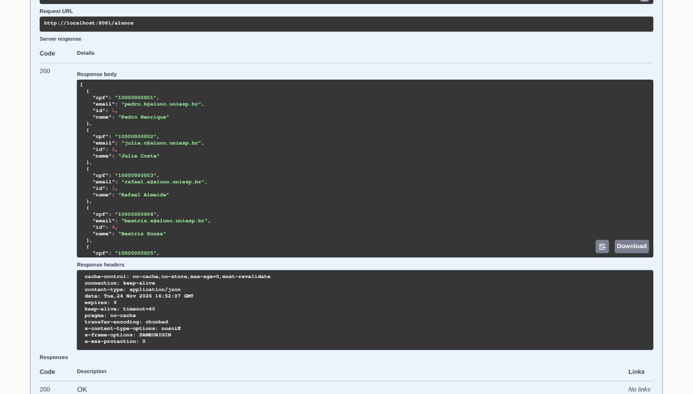

# Spring Security — plano e acompanhamento

Objetivo: realizar no Aluno Online o fluxo pedido na apresentação: cadastrar um usuário, fazer login, copiar o JWT, autorizar no Swagger e listar os dados de um controller protegido.

Para apresentar agora, siga [APRESENTACAO.md](APRESENTACAO.md), com os seis prints e o comando `bash scripts/apresentar.sh` para iniciar a aplicação e o banco dedicado.

## Situação encontrada nesta revisão

O projeto local já continha a implementação de Spring Security, os testes e este roteiro. A revisão comparou essa implementação com o ZIP `Aluno-Online-API-REST-com-Spring-Security-main.zip` e com os arquivos Java do professor no Drive. Não foi encontrada funcionalidade faltando para o fluxo solicitado. Nenhum código de produção, teste, contrato acadêmico ou script SQL precisou ser alterado nesta revisão.

Foram atualizados o resultado dos testes, a captura do Swagger e as instruções do README sobre Java 21 e o valor padrão de `DB_PASSWORD`, para corresponder à configuração existente. O ZIP do amigo foi usado como referência, sem substituir o projeto local. As etapas abaixo descrevem a implementação existente e permitem acompanhar cada responsabilidade.

## Etapa 1 — Conferir as aulas e preservar o projeto

- [x] Consultar o [Drive do professor](https://drive.google.com/drive/folders/1XlUS6vCqiof1YlOA6lMIQXjnjOQbYe19).
- [x] Conferir os exemplos das aulas 02, 04, 05, cadastro de usuários e documentação.
- [x] Identificar as alterações locais já existentes; elas serão preservadas.

Arquitetura escolhida: `Usuario` separado de `Aluno`, autenticação por `AuthenticationManager` e `UserDetailsService`, senha com `BCryptPasswordEncoder`, JWT Auth0 com HMAC256 e validade de duas horas, filtro `OncePerRequestFilter`, API sem sessão (`STATELESS`). Todos os usuários autenticados têm o mesmo acesso (`ROLE_USER`), como na aula. Não haverá funcionalidades de recuperação de senha, refresh token ou perfis administrativos.

## Etapa 2 — Cadastro e autenticação

- [x] Acrescentar Spring Security e a biblioteca `com.auth0:java-jwt` ao `pom.xml`.
- [x] Criar `model/Usuario.java`, `repository/UsuarioRepository.java` e os DTOs de cadastro, autenticação e resposta.
- [x] Criar `service/AutenticacaoService.java` para buscar o usuário pelo login.
- [x] Criar `controller/UsuarioController.java`: `POST /usuarios`, corpo `{"login":"seu-login","senha":"sua-senha"}`, resposta 201 sem expor senha e rejeição de login repetido.
- [x] Criar `controller/AutenticacaoController.java`: `POST /login`, mesmo corpo, resposta `{"token":"..."}`.

Por quê: são as mesmas responsabilidades do exemplo do professor, aplicadas aos pacotes já usados no Aluno Online. O cadastro cria somente uma nova tabela `usuarios`; as entidades acadêmicas e seus contratos não precisam mudar.

## Etapa 3 — Token e proteção das rotas

- [x] Criar `infra/security/TokenService.java`, `DadosTokenJWT.java`, `SecurityFilter.java` e `SecurityConfigurations.java`.
- [x] Adicionar `api.security.token.secret=${JWT_SECRET:12345678}` às propriedades, como o exemplo didático. Para uso fora da demonstração, configurar `JWT_SECRET` com uma chave própria.
- [x] Liberar cadastro, login, arquivos da interface e documentação. Exigir token nas operações da API.
- [x] Colocar o filtro antes de `UsernamePasswordAuthenticationFilter` e autenticar no `SecurityContextHolder` depois de validar o JWT.
- [x] Responder 401 para credencial ou token inválido; validar entrada do cadastro/login com Bean Validation.

Por quê: o filtro evita repetir verificações em todos os métodos. O token identifica o usuário a cada requisição, sem sessão HTTP.

## Etapa 4 — Swagger e interface existente

- [x] Acrescentar o esquema HTTP bearer `bearer-key` ao `config/OpenApiConfig.java`.
- [x] Acrescentar `@SecurityRequirement(name = "bearer-key")` aos controllers acadêmicos. Essa anotação é a origem do cadeado mostrado no Swagger; a proteção real é feita pelo filtro e pela configuração de segurança.
- [x] Manter cadastro e login sem cadeado.
- [x] Acrescentar somente uma tela de acesso e um script compartilhado para enviar o token nas requisições das páginas existentes, incluindo o relatório e o CSV.
- [x] Permitir o iframe de relatórios da própria aplicação (`SAMEORIGIN`).

Compatibilidade necessária: este projeto usa Spring Boot 4 e Springdoc 3; manter essas versões, em vez de copiar o Springdoc 2 das aulas, feito para outra versão do Boot. Usar emissor `API Aluno Online`, em vez do nome da aplicação médica do exemplo. Calcular as duas horas em `Instant` para manter a validade independente do fuso da máquina.

## Etapa 5 — Testar e preparar a apresentação

- [x] Criar testes de integração para cadastro, BCrypt, login, token, bloqueio anônimo e definição OpenAPI.
- [x] Executar a suíte contra PostgreSQL temporário separado dos dados originais.
- [x] Gerar o JAR com Maven usando Java 21.
- [x] Abrir o Swagger e realizar cadastro → login → Authorize → GET protegido.
- [x] Verificar os endpoints acadêmicos, os relatórios e o CSV após autenticar.
- [x] Registrar os resultados e o roteiro da apresentação neste documento.

Nenhum reset do banco original é necessário. Não executar `APP_SEED_RESET=true` para esta alteração.

## Correspondência com os arquivos do professor

Os nomes das pastas do Drive nem sempre coincidem com o número escrito no arquivo. Foram usados os conteúdos dos seguintes arquivos:

| Material | Aplicação neste projeto |
| --- | --- |
| [Aula 02.pdf](https://drive.google.com/file/d/1taCTVahH3c1BIxLkepV0qoIVXiVGx7f7/view) e [Aula 02 e 03.java](https://drive.google.com/file/d/1UfLiAnX9Cal1bTyciP-8NXd1_zsQaqXz/view) | `SecurityConfigurations`, autenticação, `UserDetails`, `ROLE_USER` e BCrypt |
| [Aula 04.java](https://drive.google.com/file/d/1r_dAgLGtzq_II-rWKpWwi7Mw9qecdq0R/view) | `TokenService`, HMAC256, emissor, login como subject, validade de duas horas e chave configurável |
| [AULA 05.java](https://drive.google.com/file/d/1BIK8CkPjeIuqE4WoW5YYbnLZdhiS-P4d/view) e [Aula 05.pdf](https://drive.google.com/file/d/1FdEvt4z4DGonF0Q83w5xnXdOP5b0KBda/view) | `SecurityFilter`, leitura do Bearer, validação do JWT e autenticação no contexto do Spring |
| [CODIGO CADASTRO USUARIO.java](https://drive.google.com/file/d/18IjQhpaM87jXinhVUeEeUeLhCgqXsovE/view) | `POST /usuarios`, senha BCrypt, rejeição de duplicidade e resposta 201 com DTO |
| [AULA 08 - documentacao.java](https://drive.google.com/file/d/14ZkTfy73w9vBi3FRHyuEk4T8oxiQ995a/view) | Rotas públicas do Swagger, esquema `bearer-key` e anotação do cadeado |

O PDF de cadastro e o exemplo de documentação também mencionam `/cadastros`; foi adotado `/usuarios`, que é a rota declarada no código Java de cadastro do professor. O projeto acadêmico não precisa das entidades da aplicação médica usada nas aulas.

## Roteiro para apresentar ao professor

1. Inicie o PostgreSQL e a aplicação com `./mvnw spring-boot:run`, configurando as variáveis do banco conforme o README. Use Java 21; nesta máquina pode ser necessário `JAVA_HOME=/usr/lib/jvm/java-21-openjdk ./mvnw spring-boot:run`.
2. Abra [o Swagger local](http://localhost:8081/swagger-ui.html).
3. Antes de autorizar, execute `GET /alunos`. A resposta deve ser **401**.
4. Abra `POST /usuarios`, clique em **Try it out** e envie um login ainda não cadastrado:

   ```json
   {"login":"apresentacao@alunoonline.com","senha":"senha-da-apresentacao"}
   ```

   A resposta deve ser **201**, com `id` e `login`, sem a senha.
5. Em `POST /login`, envie o mesmo JSON. A resposta deve ser **200**, com o campo `token`.
6. Copie somente o valor do token, sem as aspas. Clique em **Authorize**, cole no campo `bearer-key` e confirme em **Authorize**. O Swagger acrescenta `Bearer` automaticamente; não digite esse prefixo no campo.
7. Execute novamente `GET /alunos`. Agora a resposta deve ser **200**, com a lista de alunos.
8. Mostre no código:
   - **Desenho do cadeado:** a anotação `@SecurityRequirement(name = "bearer-key")` acima do controller e o esquema com esse nome em `config/OpenApiConfig.java`.
   - **Bloqueio das operações:** `.anyRequest().authenticated()` em `infra/security/SecurityConfigurations.java`.
   - **Validação a cada chamada:** `infra/security/SecurityFilter.java`, que lê o Bearer, valida o token e preenche o `SecurityContextHolder`.
   - **Criação e validade do token:** `infra/security/TokenService.java`.
   - **Senha protegida no cadastro:** `passwordEncoder.encode(...)` em `controller/UsuarioController.java`.

Se repetir o cadastro com o mesmo login, receberá **400**. Use um login novo para demonstrar o cadastro novamente. Uma senha incorreta ou um token inválido/expirado deve resultar em **401**.

O login da página inicial e a autorização do Swagger são independentes: cada interface precisa receber o token no seu próprio fluxo.


## Resultado da validação — 24/11/2026

- **Maven:** `JAVA_HOME=/usr/lib/jvm/java-21-openjdk ./scripts/test-security.sh` → **BUILD SUCCESS**.
- **Suíte:** 28 testes executados, zero falhas, zero erros e zero ignorados (27 de segurança e o teste original de contexto).
- **Banco dos testes:** PostgreSQL descartável na porta 55433, criado pelo script e removido ao finalizar; o banco original não foi acessado.
- **Swagger no navegador:** validação refeita em `http://localhost:8081/swagger-ui.html`, com banco dedicado à apresentação. GET anônimo retornou 401; cadastro retornou 201; login retornou 200 com JWT; Authorize exibiu `Authorized` e marcou os cadeados; GET /alunos retornou 200 com os dez alunos de demonstração.
- **HTTP real:** 13 verificações adicionais refeitas, incluindo os seis grupos de controllers e os relatórios. A exportação CSV retornou 200, `text/csv;charset=UTF-8` e cinco registros mais o cabeçalho. Resultados em [TESTES_SECURITY_RESULTADO.json](TESTES_SECURITY_RESULTADO.json).
- **Interface:** o mesmo usuário criado pelo Swagger entrou na aplicação e carregou o dashboard com os dados da base. O salvamento do CSV pelo navegador não foi revalidado visualmente; os endpoints de relatórios e o conteúdo do CSV foram validados por HTTP.
- **Preservação:** nenhum arquivo em `src/` nem o `pom.xml` foi alterado nesta revisão. As alterações locais anteriores foram mantidas.
- **Artefato:** `target/api-0.0.1-SNAPSHOT.jar`.

A validação existente para senhas acima de 72 bytes também foi conferida: o cadastro retorna 400 com mensagem clara. O limite é medido em UTF-8, inclusive para caracteres acentuados e emojis. O teste de senha longa no login passou, retornando 401.

A instância atual foi iniciada em `http://localhost:8081` com `bash scripts/apresentar.sh`, conectada ao banco dedicado `aluno_online_demo` na porta 55434. O banco original na porta 5432 não foi iniciado nem alterado. O script guarda a base da apresentação em `.demo/`, ignorada pelo Git, para preservar os cadastros entre reinicializações. Ao encerrar o script com Ctrl+C, ele para a aplicação e o banco que iniciou.

Conta de demonstração criada durante este teste do Swagger: login `johann.swagger.2411`, senha `Apresentacao123`. Para demonstrar um cadastro novo, use outro login. Essa conta existe somente na base de apresentação da porta 55434.


